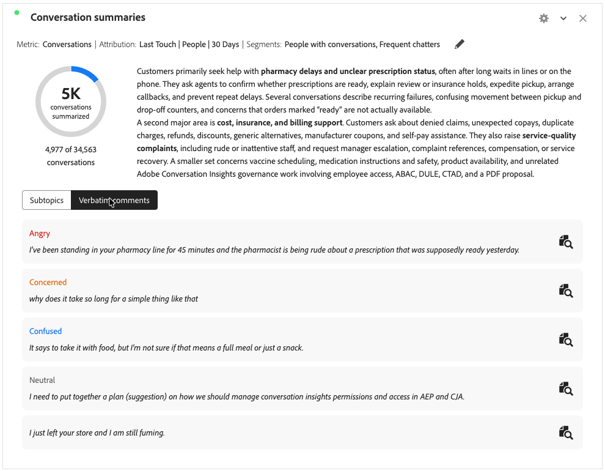

# 对话摘要 {#conversation-summaries}

>[!CONTEXTUALHELP]
>id="workspace_conversationsummaries_button"
>title="对话摘要"
>abstract="创建可视化图表，汇总筛选出的一组对话。"

>[!CONTEXTUALHELP]
>id="workspace_conversationsummaries_panel"
>title="对话摘要"
>abstract="汇总筛选出的一组对话。 控制摘要的长度。 查看具有代表性的客户原话，验证所提取信号的准确性。 选择一个引用，打开完整的对话重播。"

{{release-limited-testing}}

 **[!UICONTROL 对话摘要]**&#x200B;可视化图表允许您摘要经过筛选的对话组。

当您将可视化配置为包含子主题时，该可视化图表会显示所选量度的摘要（例如，“对话”），并显示子主题或逐字注释。

## 创建和配置 {#conversation-summaries-create-configure}

>[!CONTEXTUALHELP]
>id="workspace_conversationsummaries_usenondefaultattributionmodel"
>title="使用非默认的属性模型"
>abstract="为这个量度启用一个非默认的归因模型。"

>[!CONTEXTUALHELP]
>id="workspace_conversationsummaries_usenondefaultattributionmodel_disabled"
>title="使用非默认的属性模型"
>abstract="非默认归因模型不适用于这个量度。"

创建和配置&#x200B;**[!UICONTROL 对话摘要]**&#x200B;可视化图表：

1. 添加 **[!UICONTROL 对话摘要]**&#x200B;可视化图表。 请参阅[将可视化图表添加到面板](/help/analysis-workspace/visualizations/freeform-analysis-visualizations.md#add-visualizations-to-a-panel)。

1. 在&#x200B;**[!UICONTROL 对话摘要]**&#x200B;可视化图表配置中：

   1. 选择&#x200B;**[!UICONTROL 指标]**。 例如： **[!UICONTROL 对话]**。
   1. 如果您想要在量度上使用非默认的[归因](/help/analysis-workspace/attribution/models.md)模型，请选择&#x200B;**[!UICONTROL 使用非默认归因模型]**，然后选择&#x200B;**[!UICONTROL 模型]**、**[!UICONTROL 容器]**&#x200B;和&#x200B;**[!UICONTROL 回顾窗口]**。
   1. 或者，您也可以将区段应用于可视化图表。 从&#x200B;**[!UICONTROL 区段]**&#x200B;下拉菜单中选择一个区段。

1. 选择&#x200B;**[!UICONTROL 生成]**&#x200B;以生成可视化图表。 选择&#x200B;**[!UICONTROL 重置]**&#x200B;将配置值重置为默认值。 选择&#x200B;**[!UICONTROL 取消]**&#x200B;以取消配置。

要重新配置&#x200B;**[!UICONTROL 对话摘要]**&#x200B;可视化图表，请选择&#x200B;**[!UICONTROL 指标： _指标_]**或&#x200B;**[!UICONTROL 指标：_指标_]**&#x200B;旁边的 | **[!UICONTROL 区段：_区段_]**。

## 使用

要使用可视化图表，请执行以下操作：

>[!BEGINTABS]

>[!TAB 子主题]

>[!TAB 逐字注释]

>[!ENDTABS]

* 如果您有[包含的子主题](#settings)，请选择&#x200B;**[!UICONTROL 子主题]**&#x200B;显示子主题，或选择&#x200B;**[!UICONTROL 逐字注释]**&#x200B;显示逐字注释。
* 选择&#x200B;**[!UICONTROL 逐字注释]**&#x200B;后，选择为逐字注释所属的特定对话打开新的[**[!UICONTROL 对话评论]**](./conversation-review.md)可视化图表。

## 设置

以下特定的[可视化设置](/help/analysis-workspace/visualizations/freeform-analysis-visualizations.md#settings)可用。

| 设置 | 描述 |
|---|---|
| **[!UICONTROL 摘要长度]** | 指定摘要的长度。 您可以选择介于&#x200B;**[!UICONTROL 短]**&#x200B;或&#x200B;**[!UICONTROL 长]**&#x200B;之间。 |
| **[!UICONTROL 包括子主题]** | 选择&#x200B;**[!UICONTROL 包括子主题]**&#x200B;以在可视化图表中显示子主题。 使用&#x200B;**[!UICONTROL 最大子主题数]**&#x200B;来配置要显示的最大子主题数。 |
