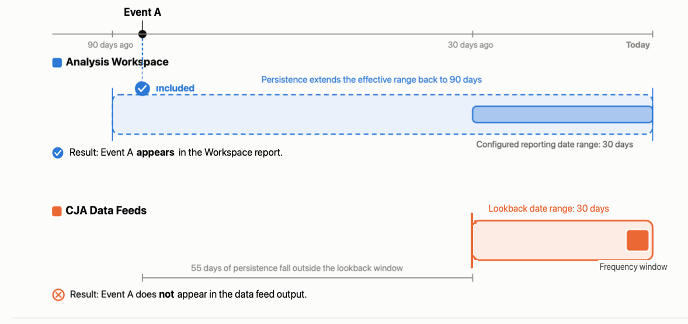

# 了解数据馈送和Analysis Workspace之间的数据差异

{{release-limited-testing}}

数据馈送导出中的数据并不总是与您在Analysis Workspace中看到的数据完全匹配。 本页上的信息说明了一些主要原因。

## 处理窗口（数据馈送）与报表窗口(Analysis Workspace)的比较 {#processing-window}

每个数据馈送提交都使用滚动的30天处理时段。 处理窗口提供在数据馈送投放中对事件进行分类所需的历史上下文。 有关处理窗口的详细信息，包括示例，请参阅[了解处理窗口](/help/components/exports/cja-data-feeds/create-feed.md#data-feed-processing-window)。

从这个意义上说，处理窗口类似于Analysis Workspace中的报表窗口（您为报表选择的日期范围）。 然而，两者之间有着关键的区别。

| 主要差异 | 报表窗口(Analysis Workspace) | 处理窗口（数据馈送） |
|---------|---------|----------|
| **数据边界** &#x200B;数据是否包含在报表或馈送中 | 灵活
如果事件受以下任何因素的影响，则仍可以将其包含在Workspace报表中：
<ul><li>**Dimension持久性**：使用会话、自定义时间或量度[过期时间](/help/data-views/component-settings/persistence.md#expiration-settings)时，持久性可能超出报告窗口。 与使用人员报告窗口[过期时间](/help/data-views/component-settings/persistence.md#expiration-settings)的报告窗口相同。 数据会被聚合。</li><li>**区段鉴别**：默认情况下，区段可以超出报表窗口。
用户在创建区段时，可以选择将区段限制在报告窗口内。<!--add link to new docs-->
</li><li>**会话计算**：会话可以超出报告窗口。 </li><li>**派生字段转换**</li></ul> | 固定
超出处理窗口的事件通常不会影响数据馈送。 处理窗口适用于以下因素：
<ul><li>**Dimension持久性**：使用自定义时间[过期](/help/data-views/component-settings/persistence.md#expiration-settings)时，在处理窗口之外（最长90天）持续存在，与Workspace中的情况相同。 使用人员报告窗口[过期时间](/help/data-views/component-settings/persistence.md#expiration-settings)时，在处理窗口之外无法持续存在。 数据不会聚合。</li><li>**区段鉴别**：始终限于处理窗口。</li><li>**会话计算**：始终限于处理时段。</li><li>**派生字段转换**：引用容器的任何派生字段函数在数据馈送导出中使用处理窗口。</li></ul> |
| **报告的时间范围** &#x200B;报告或信息源中包含哪些事件 | 与报告窗口相同。 | 与处理窗口不同。 
要报告的时间范围是频率窗口，它可以是一小时，也可以是处理窗口末尾的一天。
 |

>[!BEGINSHADEBOX]

**示例**

以下示例说明了报表窗口和处理窗口之间的差异如何导致Workspace报表和数据馈送交付之间存在数据差异。

45天前具有人员容器且今天有事件的用户符合区段的资格条件。 具有30天报告窗口的Workspace报表包含用户事件，因为默认情况下，区段可以超出报告窗口。 今天的数据馈送交付不包括事件，因为区段资格限制为30天的处理时段。

<!-- update the following graphic -->

>[!ENDSHADEBOX]

## 拼接重播

每次运行拼接重放时，历史身份数据都会进行追溯更新。

数据馈送和Analysis Workspace对拼接重播的处理方式不同，如下所示：

* **数据馈送**：仅在导出时反映拼接的标识。 重放结果不会逆向应用于导出的文件。

* **Analysis Workspace**：显示最新拼接数据，每次重放运行时都会追溯更新。 每次重放后历史数据都会发生更改，因此Workspace始终反映最新的身份分辨率。

## 迟到的事件

在数据馈送中，事件可能会在数据馈送导出窗口关闭后到达。

数据馈送和Analysis Workspace对于过去事件的功能有所不同，如下所示：

* **数据馈送**：根据收到事件的时间，导出固定时间范围内的数据。

  在窗口关闭后到达的事件可能不包括在导出中。 这受您选择的[处理延迟](/help/components/exports/cja-data-feeds/create-feed.md#data-feed-processing-delay)影响。

* **Analysis Workspace**：在报告时处理数据，因此事件包含在报告中，而不管它们是在何时收到的。

## 数据批处理

有时，数据会以跨越较长时段的批处理提交。

数据馈送和Analysis Workspace在批量数据方面的功能有所不同，如下所示：

* **数据馈送**：根据原始时间戳，在每天或每小时分发批处理数据。 例如，包含30天数据的批次会分布在30天的导出中，因此在任何单个导出中只显示一小部分。

* **Analysis Workspace**：在批处理完全处理完毕后立即显示批处理中的所有数据，而不考虑批处理中包含的时间范围。

