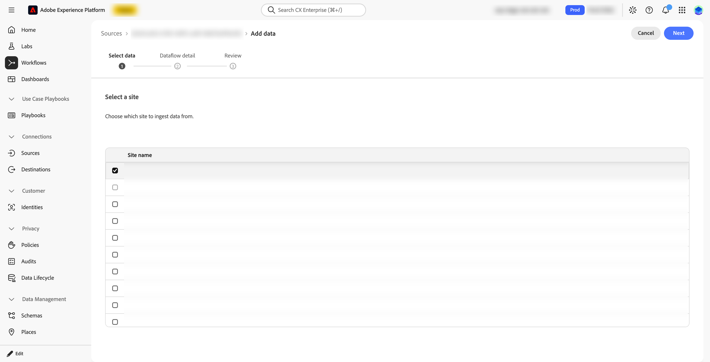

# 设置和配置入站集成

本文详细介绍了用于设置和配置品牌可见度与Customer Journey Analytics的入站集成的[先决条件](#prerequisites)、[责任](#responsibilities)、[验证步骤](#verification)、[故障排除步骤](#troubleshoot)和[完成条件](#completion-criteria)。

## 先决条件

在启用集客集成之前，请考虑以下先决条件。 使用下面的[验证过程](#verification)确认每个必备项。

### BYOCDN日志转发

对于每个品牌可见度站点，必须将CDN访问日志转发到Adobe Brand Visibility并由其接收，然后品牌可见度源连接器才可行。

此要求适用于每个品牌可见度站点。 一个站点、域或子域的CDN配置或日志馈送仅涵盖该站点。

确认移交的两个部分：

1. 您已配置相关的CDN或日志管道，以将所需的访问日志转发到Adobe提供的Amazon S3目标。
1. 品牌可见度正在接收和检测相关站点的日志。 然后，便可以在Experience Platform的Adobe Brand Visibility源中选择该站点。

BYOCDN日志转发提供用于自动代理流量分析的服务器端CDN请求数据。 数据并不依赖于浏览器中运行的JavaScript标记。 必需
CDN日志馈送可确保下游摘要数据集包含预期的品牌可见度代理流量数据。 有关详细信息，请参阅[BYOCDN日志转发引用](https://experienceleague.adobe.com/en/docs/brand-visibility/using/log-forwarding/log-forwarding-overview)。

### 所需信息

确保您具有下表所列每个品牌可见度站点的所有必需详细信息的值。

| 所需值 | 验证或注释 |
|---|---|
| 品牌可见度网站或域 | 确认CDN日志转发涵盖的站点。 |
| CDN提供商 | 识别为站点服务的CDN。 |
| CDN日志转发状态 | 证明站点的日志已转发并由品牌可见度检测。 |
| 品牌可见度源中可用的站点 | 确认该站点可供在品牌可见度源中选择。 根据品牌可见度中已解析的CDN日志的可用性，站点可用。 |
| IMS组织 | 使用与Experience Platform关联的确切IMS组织。 |
| 沙盒 | 使用为集客集成指定的确切沙盒名称。 |
| 连接 | 确定应包含数据集的客户历程连接。 |
| 数据视图 | 确定应包含组件的新数据视图或现有Customer Journey Analytics数据视图。 |
| 管理员或所有者 | 提供作为配置联系人的名称或团队。 |

在继续之前，请确认每个站点都可在Adobe Brand Visibility源中选择。

### 沙盒

当数据集出现在沙盒中的&#x200B;**[!UICONTROL 数据集]**&#x200B;中后，即可将该数据集添加到CJA连接。

确认以下内容：

* IMS 组织
* Target Experience Platform沙盒

目标AEP沙盒与相应的Customer Journey Analytics连接或包含数据集的连接使用的命名沙盒相同。

只有在Adobe确认已创建托管数据集后，客户才能将数据集添加到适当的CJA连接。

### 摘要数据集

入站集成在Experience Platform中提供汇总的摘要数据集，其中包含与LLM、机器人和自动代理关联的服务器端CDN请求信息
流量。

Brand Visibility使用CDN访问日志来识别来自机器人和自动代理的请求。 此流量不会触发浏览器JavaScript标签，因此不会通过传统的Web分析实施来捕获。

有关入站集成、数据集结构和可用字段的详细说明，请参阅[关于数据集](#about-the-dataset)。

品牌可见度源使用以下方式在Experience Platform中创建摘要数据集：

* **[!UICONTROL XDM摘要量度]**&#x200B;类
* **[!UICONTROL CDN请求摘要]**&#x200B;字段组
* 在&#x200B;**[!UICONTROL cdn]**&#x200B;对象下组织的字段

连接器使用以下命名模式为每个品牌可见度站点创建数据集： <code>Adobe Brand Visibility (ABV)数据集 — _不含方案的baseUrl_</code>.  例如<https://example.com>网站的`Adobe Brand Visibility (ABV) Dataset - example.com`。

在采用此命名约定之前创建的数据集显示早期模式<code>LLM优化(LLMO)数据集 — _baseUrl，没有方案_</code>.

在创建数据流的沙盒中的&#x200B;**[!UICONTROL 数据集]**&#x200B;中查找数据集……

数据集是汇总的摘要数据。 在Customer Journey Analytics中分析请求卷时，请使用提供的&#x200B;**[!UICONTROL CDN请求计数]**&#x200B;量度，而不是计算数据集行数。

验证在为特定品牌可见度站点创建的数据集架构中的可用字段。 要计划数据视图的配置，请查看字段。

## 责任

启用品牌可见度源后，品牌可见度：

* 为您选择的站点交付摘要数据集。
* 将数据集登陆到您在其中创建数据流的沙盒中。

您作为客户的责任包括：

* 确保每个品牌可见度站点的CDN日志转发给品牌可见度并由用户接收。
* 要在正确的沙盒中启用品牌可见度源，请确认您的站点可供选择，然后选择该站点。
* 选择应包含数据集的Customer Journey Analytics连接。
* 将数据集添加到该连接。
* 在相关的Customer Journey Analytics数据视图中选择要作为组件显示的字段。
* 验证生成的维度和量度是否支持预期的分析。

>[!IMPORTANT]
>
>创建并填充Experience Platform数据集后，托管连接器会特意停止。 Adobe不会修改您的Customer Journey Analytics连接或数据视图。

在将数据集添加到连接之前，该数据集不可用于Customer Journey Analytics分析。 数据
直到已将相关字段添加到数据视图，用户才能通过数据视图使用该选项。

要启用源：

1. 在Experience Platform中，选择要存储数据集的沙盒。 网站只能分配一次，因此请确保此沙盒是您想要的。
1. 依次转到&#x200B;**[!UICONTROL 源]**、**[!UICONTROL 目录]**&#x200B;和Adobe应用程序。 在&#x200B;**[!UICONTROL Adobe Brand Visibility]**&#x200B;卡上，首次选择&#x200B;**[!UICONTROL 设置]**。 之后，卡会显示&#x200B;**[!UICONTROL 添加数据]**。

   

1. 选择&#x200B;**[!UICONTROL 添加数据]**。

   

1. 在➊ **[!UICONTROL 选择数据]**&#x200B;步骤中：

   1. 从&#x200B;**[!UICONTROL 站点名称]**&#x200B;表中选择站点。 将站点分配给数据流后，您将无法在该沙盒或任何其他沙盒中再次选择站点。

      

   1. 选择&#x200B;**[!UICONTROL 下一步]**。

1. 在➋ **[!UICONTROL 数据流详细信息]**&#x200B;步骤上：

   1. 输入&#x200B;**[!UICONTROL 数据流名称]**&#x200B;和可选的&#x200B;**[!UICONTROL 描述]**。 您还可以订阅警报&#x200B;**[!UICONTROL 源数据流运行开始]**、**[!UICONTROL 源数据流运行成功]**&#x200B;和&#x200B;**[!UICONTROL 源数据流运行失败]**。

      

   1. 选择&#x200B;**[!UICONTROL 下一步]**。

1. 在➌ **[!UICONTROL 审核]**&#x200B;步骤中：

   1. 检查连接和数据集分配。

      

   1. 选择&#x200B;**[!UICONTROL 完成]**。

数据集是自动分配的，不需要字段映射。

>[!IMPORTANT]
>
>一个站点只能分配一次。 要在其他沙盒中使用站点，请删除站点所分配的数据流。 删除数据流将影响依赖该源数据的任何Customer Journey Analytics连接或数据视图。
>

## 验证

请使用以下过程验证集客集成：

1. 确认ABV站点和CDN日志已准备就绪。

   对于每个ABV站点：

   * 确认CDN日志转发所涵盖的确切站点或域。
   * 确认该站点在Experience Platform的品牌可见度源中可供选择。 根据品牌可见度中已解析的CDN日志的可用性，站点可用。
   * 不要继续执行“CDN日志已启用”的常规声明。 当特定的ABV站点可供选择时继续。
   * 确认品牌可见度正在接收或检测该站点的日志。
   * 从Adobe获取站点的品牌可见度准备情况确认。

1. 在Experience Platform中验证数据集。

   创建数据流后：
   1. 登录到&#x200B;**[!UICONTROL Experience Platform]**。
   1. 选择您在其中创建数据流的沙盒。
   1. 在&#x200B;**[!UICONTROL 数据集]**&#x200B;中找到品牌可见度网站的数据集。
   1. 确认数据集与预期的品牌可见度站点关联。
   1. 记录&#x200B;**[!UICONTROL 数据集ID]**&#x200B;并链接&#x200B;**[!UICONTROL 架构]**。
   1. 查看数据集记录计数、最新摄取信息以及可用的示例数据（如果允许）。
   1. 打开链接的架构并验证预期的XDM结构：
      * 类： **[!UICONTROL XDM摘要量度]**
      * 字段组：**[!UICONTROL CDN请求摘要]**
      * 对象： **[!UICONTROL cdn]**
      * 所需的维度和量度，如&#x200B;**[!UICONTROL botType]**、**[!UICONTROL cdnProvider]**、**[!UICONTROL url]**、**[!UICONTROL 主机]**、**[!UICONTROL 状态]**、**[!UICONTROL 请求]**&#x200B;和&#x200B;**[!UICONTROL timeToFirstByte]**。

1. 将数据集添加到连接

   您的Customer Journey Analytics管理员必须将数据集添加到预期连接：

   1. 登录Customer Journey Analytics。
   1. [创建新连接或编辑预期的现有连接](/help/connections/create-connection.md)。 确认连接使用的是创建数据集的相同Experience Platform沙盒。
   1. 按名称或数据集ID搜索数据集。
   1. 将数据集添加到连接。
   1. 根据客户的Customer Journey Analytics设计配置数据集设置。
   1. 保存连接。
   1. 要确认包含数据集且正在引入，请查看连接详细信息。

1. 配置或更新数据视图

   数据集成为连接的一部分后：
   1. 登录Customer Journey Analytics。
   1. [创建新数据视图或编辑与预期报告用例关联的数据视图](/help/data-views/create-dataview.md)。
   1. 选择包含托管品牌可见度数据集的连接。
   1. 将所需的架构字段添加为维度或量度。
   1. 包括计划分析所需的字段，例如：
      * **[!UICONTROL CDN机器人类型]**
      * **[!UICONTROL CDN提供程序]**
      * **[!UICONTROL CDN URL]**
      * **[!UICONTROL CDN主机]**
      * **[!UICONTROL CDN HTTP状态]**
      * **[!UICONTROL CDN请求计数]**
      * **[!UICONTROL CDN到第一个字节的平均时间]**
   1. 保存数据视图。
   1. 验证Analysis Workspace或客户选择的报表工作流中的字段。

1. 验证端到端结果

   使用最近的报告时段并验证：

   * 预期的品牌可见度站点将呈现。
   * 预期的CDN提供程序和主机值存在。
   * 表示机器人或自动代理流量。
   * URL和HTTP状态维度包含预期值。
   * 提供了CDN请求计数和性能量度。
   * 数据集包含在预期连接中。
   * 必填字段在预期数据视图中显示。

数据可用所需的确切时间取决于摄取和Customer Journey Analytics处理工作流。

## 疑难解答

如果出现问题，请查看以下步骤：

* 该数据集未出现在AEP中。

  验证：

  * IMS组织正确。
  * 选定的Experience Platform沙盒是正确的。
  * 源已在CDN日志转发工作后启用。
  * 使用了Adobe提供的数据集名称或ID。
  * 已为正确的品牌可见度站点创建数据集。

* 该数据集存在，但不包含预期的数据。

  验证：
  * 正在转发确切品牌可见度站点的CDN日志。
  * 品牌可见度正在接收或检测站点的日志。
  * CDN配置中的站点或域与品牌可见度站点匹配。
  * 在确认CDN日志就绪后启用了托管连接器。
  * 选定的日期范围包括日志摄取开始后的时间段。

* 该数据集存在于Experience Platform中，但在Customer Journey Analytics中不可用。

  验证：
  * Customer Journey Analytics连接使用相同的命名Experience Platform沙盒。
  * 数据集已明确添加到连接。
  * Customer Journey Analytics管理员具有所需的权限。
  * 添加数据集后已保存连接。

* 数据集在连接中，但字段不可用于报告。

  验证：
  * 数据视图选择正确的Customer Journey Analytics连接。
  * 预期的架构字段已添加为数据视图组件。
  * 这些字段放置在&#x200B;**[!UICONTROL 维度]**&#x200B;或&#x200B;**[!UICONTROL 量度]**&#x200B;部分中。
  * 数据视图在添加组件后保存。
  * 数据集架构与预期的&#x200B;**[!UICONTROL CDN请求摘要]**&#x200B;字段组结构匹配。

* 站点不在列表中。

  验证：

  * 可以根据品牌可见度中已解析的CDN日志的可用性来选择站点。
  * 已设置CDN日志转发并为站点工作。

* 无法选择站点。

  请注意，一旦网站被分配给数据流，就无法在该沙盒或任何其他沙盒中再次选择它。 要在其他沙盒中使用站点，请删除站点所分配的数据流。 然后，可以再次选择站点。 删除数据流将影响依赖该源数据的任何Customer Journey Analytics连接或数据视图。

* 数据流显示失败状态。

  使用&#x200B;**[!UICONTROL 监控]**&#x200B;仪表板。 **[!UICONTROL 源]**&#x200B;概述指出，已自动禁用连续30天失败的源数据流。

## 完成条件

在确认以下所有条件后，集客集成便可用于客户端Customer Journey Analytics配置：

* 品牌可见度会为每个请求的ABV站点转发并接收CDN日志。
* 可在Adobe Brand Visibility源中选择每个品牌可见度站点。
* 您在目标沙盒中启用了Adobe Brand Visibility源。
* 每个站点的摘要数据集将显示在该沙盒中。
* 您已验证数据集及其XDM架构。
* 您已将数据集添加到预期的CJA连接。
* 您已配置相关的CJA数据视图组件。

